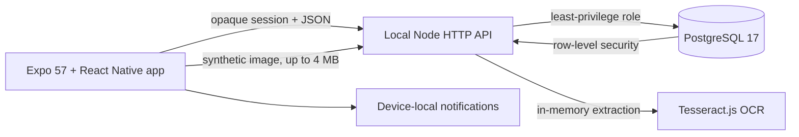

# Alaga

Alaga is a warm, patient-first medicine care log for families coordinating care at home. It helps a caregiver confirm schedules, see what needs attention, and record who handled each dose without guessing that an unrecorded dose was missed.

> Alaga is a student portfolio project. Use synthetic information only. It does not diagnose, prescribe, or provide medical advice.

## What it demonstrates

- Account-backed patient ownership and caregiver sharing.
- Confirmed, versioned medicine schedules with fixed, interval, and meal-window timing.
- A chronological Today care log with attributable Taken, Skipped, Snoozed, and correction events.
- A seven-day read-only history and reversible medicine archiving.
- Opt-in local reminders with private lock-screen wording.
- Reviewable local OCR drafts that preserve source wording and never turn vague instructions into exact times.
- Persisted English and Filipino interface settings.
- Large-text reflow, labelled icon actions, 48dp targets, light and dark themes, and patient-first safety context.

## Architecture



The mobile client never connects to PostgreSQL. The API hashes session tokens and sets the authenticated account context for membership-backed row-level security. Medication revisions and dose history are retained rather than overwritten. Selected images are validated, processed in memory, and not persisted.

## Run the local demo

Requirements:

- Node.js 22
- PostgreSQL 17 on `127.0.0.1:5432`
- Expo Go for the Android device path

Install dependencies and copy the example environment values into ignored local environment files. Replace the PostgreSQL placeholders before setup.

```powershell
npm.cmd install
npm.cmd run db:setup
npm.cmd run db:reset:synthetic -- --confirm-synthetic-reset
```

For a USB-debugging Android phone, one supervised command starts the API and Expo, restores port forwarding, and reopens Expo Go:

```powershell
npm.cmd run dev:usb
```

Otherwise, start the services in separate terminals:

```powershell
npm.cmd run server
npx.cmd expo start
```

Then verify the live handoff:

```powershell
npm.cmd run check:runtime
```

The deterministic demo owner is `maya@example.test` with password `alaga-synthetic-only`. The reset also creates caregiver `paolo@example.test`, patient `Lola Rosa (Synthetic)`, two medicines, and a small attributable history.

Follow the [five-minute portfolio demo](docs/portfolio-demo.md) for a repeatable walkthrough.

## Verification

```powershell
npm.cmd run verify
npm.cmd run export:android
npm.cmd run test:ocr:smoke
```

The test suite covers authentication, patient isolation, row-level security, caregiver permissions, schedule versioning, archive retention, dose-event idempotency, localization invariants, reminder planning, OCR safety rules, and local-runtime recovery. The Android export gate also rejects unsupported Expo Go push-registration imports.

## Current boundary

Alaga is intentionally local and Android-first. It has no hosted service, verified email delivery, remote push, offline writes, or production monitoring. Real patient data, real medicine labels, pilot use, and clinical deployment are out of scope. iOS and full TalkBack focus-order validation remain environment-dependent follow-up checks.

## Project notes

- [Product decisions](docs/product-decisions.md)
- [Prototype architecture](docs/prototype-architecture.md)
- [Local development setup](docs/development-setup.md)
- [Manual acceptance checklist](docs/manual-test-checklist.md)
- [Current roadmap handoff](docs/agents/next-milestone.md)
